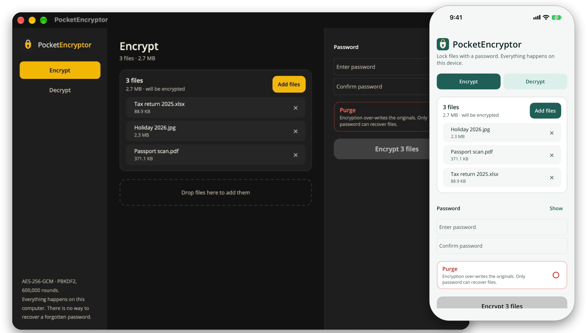
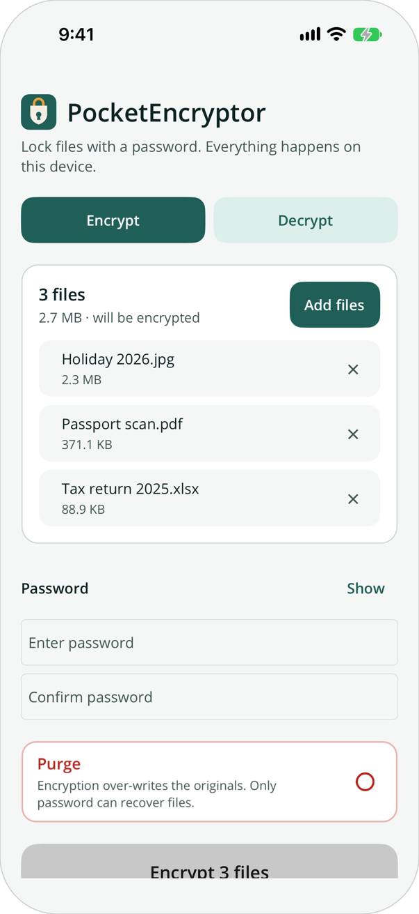
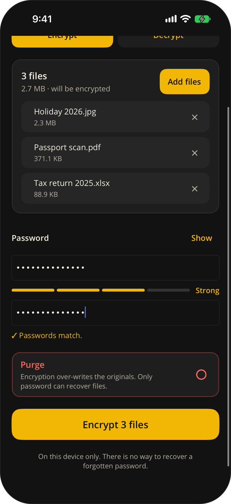
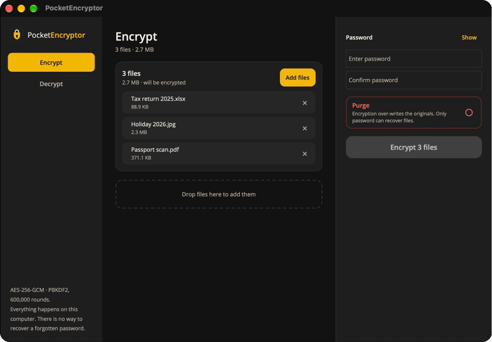
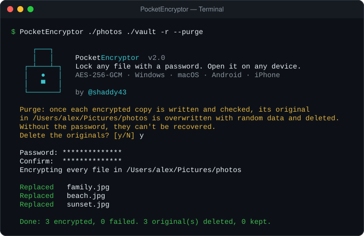

<p align="center">
  
</p>

<h1 align="center">PocketEncryptor</h1>

<p align="center">
  <strong>Lock a file on one device. Open it on any other.</strong>
</p>

<p align="center">
  
  
  
  
</p>

<p align="center">
  <a href="#download">Download</a> ·
  <a href="#how-it-works">How it works</a> ·
  <a href="#command-line">Command line</a> ·
  <a href="#under-the-hood">Under the hood</a> ·
  <a href="#build-it-yourself">Build it yourself</a>
</p>

<p align="center">
  
</p>

PocketEncryptor is a small, simple app that encrypts your files with a password. A file you lock on your Android phone opens on your Windows PC, your Mac or your iPhone, and the other way round. It's the same app, the same file and the same password everywhere.

There's no account, no cloud and no internet: just your file, your password and strong encryption.

| | |
| --- | --- |
| 🔒 **Strong** | AES-256-GCM encryption. A wrong password or a tampered file is always detected |
| 🔁 **Everywhere** | Android, iPhone and iPad, macOS, Windows, and a command-line tool, all reading the same `.pkec` files |
| 👆 **Simple** | Pick files, type a password, press one button |
| 🕶️ **Private** | Works offline, asks for no permissions, collects nothing ([privacy policy](PRIVACY.md)) |

## Screenshots

<table>
  <tr>
    <td align="center" width="50%">
      <br>
      <sub><b>iPhone, light mode.</b> Pick several files at once</sub>
    </td>
    <td align="center" width="50%">
      <br>
      <sub><b>iPhone, dark mode.</b> Password strength and a match check</sub>
    </td>
  </tr>
  <tr>
    <td colspan="2" align="center">
      <br>
      <sub><b>Mac and Windows.</b> A wider layout with drag and drop</sub>
    </td>
  </tr>
</table>

## Download

Get the latest version from the [Releases page](https://git.shaddy43.com/shaddy43/PocketEncryptor/releases).

| Platform | File | How to start |
| --- | --- | --- |
| **Windows** 10 / 11 | `PocketEncryptor-2.0-windows-x64.zip` | Unzip anywhere and run `PocketEncryptor.App.exe`. Nothing to install |
| **macOS** 14 or later | `PocketEncryptor-2.0-macos.zip` | Unzip and drag PocketEncryptor to Applications |
| **Android** 5 or later | `PocketEncryptor-2.0-android.apk` | Open it on the phone and allow the install |
| **iPhone / iPad** | Not downloadable yet | Coming to the App Store; until then, build it yourself ([RUNBOOK](RUNBOOK.md#4-iphone-on-the-mac)) |
| **Command line** | `PocketEncryptor-CLI-2.0-*.zip` | One file: `PocketEncryptor.exe` (Windows) or `PocketEncryptor` (Mac) |

These builds aren't signed by Microsoft or Apple yet, so the first launch asks you to confirm:

- **Windows:** "Windows protected your PC" → **More info → Run anyway**.
- **macOS:** if it can't be opened or "is damaged", go to **System Settings → Privacy & Security → Open Anyway**, or run `xattr -dr com.apple.quarantine /Applications/PocketEncryptor.app`.
- **Android:** allow your browser or Files app to **install unknown apps**.

## How it works

1. **Choose files.** Any files to encrypt, or `.pkec` files to decrypt; the app switches mode for you.
2. **Enter a password.** Twice when encrypting.
3. **Press the button** and choose where to save.

That's it. `photo.jpg` becomes `photo.jpg.pkec`; send it, store it or back it up anywhere. On any device, open the `.pkec` file with the same password to get `photo.jpg` back.

> [!IMPORTANT]
> **Keep your password safe.** It is never stored anywhere, and there is no way to recover a file without it.

You can also bring files straight in:

| | |
| --- | --- |
| **Android** | **Share → PocketEncryptor** from Files, Gallery or any app; tap a `.pkec` file and choose **Open with** |
| **iPhone / iPad** | Tap a `.pkec` file in Files, or **Share → PocketEncryptor** |
| **macOS** | Drag files onto the window, or **Open With → PocketEncryptor** in Finder |
| **Windows** | Drag files from File Explorer onto the window |

### Good to know

- **Many files at once.** Pick several and choose one folder; every file gets its own result, so one failure doesn't stop the rest.
- **Nothing is overwritten.** If a name is taken, the result is saved as `photo (1).jpg.pkec`.
- **No broken files.** A wrong password never produces an output file: every result is checked in full before it's saved.

### Purge: replace originals with encrypted copies

Tick **Purge** when encrypting to swap your files for their encrypted versions. For each file the app saves the encrypted copy, checks that it decrypts with your password, and only then overwrites the original with random data and deletes it. It asks for confirmation every time.

Some originals can't be deleted by the app and are kept and listed, such as read-only files and files shared from another app. No app can promise a deleted file leaves no trace (SSDs, backups, cloud sync and the Recycle Bin keep their own copies), so turn on full-disk encryption (BitLocker, FileVault; phones have it built in) as well.

## Command line

<p align="center">
  
</p>

```
PocketEncryptor <file> <output> -E [--purge]      encrypt a file
PocketEncryptor <file> <output> -D                decrypt a file
PocketEncryptor <folder> <output> -r [--purge]    encrypt every file in a folder
```

The password is asked for with masked input, never passed on the command line. Files from the CLI and the apps open in each other. `PocketEncryptor --help` lists everything.

```
PocketEncryptor notes.txt notes.txt.pkec -E
PocketEncryptor notes.txt.pkec notes.txt -D
PocketEncryptor ./photos ./photos-encrypted -r --purge
```

`--purge` works like Purge in the apps: it asks first, then for each file writes the encrypted copy, checks that it decrypts, and only then overwrites the original with random data and deletes it. Originals it can't delete, such as read-only files, are kept and listed. Without `--purge`, originals are never touched. To encrypt a folder in place, give it as both input and output.

## Under the hood

- **Encryption:** AES-256-GCM, which keeps the file secret *and* detects any change to it.
- **Password to key:** PBKDF2-HMAC-SHA256 with 600,000 iterations and a random salt per file, so the same file encrypted twice looks completely different.
- **Any size, even on phones:** files are encrypted in 64 KiB chunks with constant memory. Reordered, missing or extra chunks are detected.
- **Safe writes:** results are written to a private temporary file and moved into place only once complete and verified.
- **Memory hygiene:** keys and plaintext buffers are pinned and zeroed after use. (The password text itself can't be wiped: .NET strings are immutable.)
- **Compatible:** files from version 1 still decrypt; new files use format v2.

<details>
<summary><b>File format (v2)</b></summary>

    [4 bytes]  magic "PKEC"
    [1 byte]   format version 0x02
    [4 bytes]  PBKDF2 iterations (uint32, big-endian)
    [4 bytes]  chunk size in bytes (uint32, big-endian; default 65536)
    [16 bytes] PBKDF2 salt
    [7 bytes]  random nonce prefix
    then one or more chunks, each:
    [<= chunk size bytes] ciphertext
    [16 bytes]            AES-GCM authentication tag

Chunk `i` is sealed with nonce `prefix || i (uint32 BE) || final_flag (1 byte)` and the 36-byte header as associated data. Every chunk except the last holds exactly `chunk size` bytes of plaintext. See `PocketEncryptor.Core/PkecFormat.cs`, which also describes the legacy v1 layout.

</details>

## Build it yourself

You need the [.NET 10 SDK](https://dotnet.microsoft.com/download) and the MAUI workload (`dotnet workload install maui`). iPhone and Mac builds need a Mac with Xcode.

```
dotnet test PocketEncryptor.Tests                                          # tests
dotnet build PocketEncryptor.App -f net10.0-windows10.0.19041.0 -t:Run     # Windows app
dotnet build PocketEncryptor.App -f net10.0-android -t:Run                 # Android (device or emulator attached)
dotnet build PocketEncryptor.App -f net10.0-maccatalyst -t:Run             # Mac app
dotnet run --project PocketEncryptor.Cli -- notes.txt notes.txt.pkec -E    # CLI
```

- **[RUNBOOK.md](RUNBOOK.md):** day-to-day commands for building, running and installing every app, including the Android SDK setup and iPhone installs.
- **[RELEASING.md](RELEASING.md):** making a release, and the notes for Google Play and the App Store.

```
PocketEncryptor.Core/   encryption and file format, shared by everything
PocketEncryptor.App/    the app (.NET MAUI): Windows, macOS, iOS, Android
PocketEncryptor.Cli/    command-line tool
PocketEncryptor.Tests/  tests for the core
scripts/                release build scripts
docs/images/            screenshots used in this README
```

<p align="center"><sub>Made by @shaddy43</sub></p>
